<p align="center">
  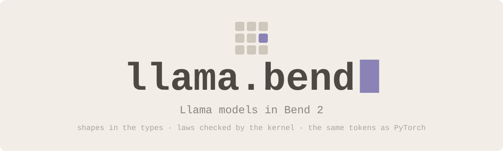
</p>

<p align="center">
  <a href="https://github.com/nuxyel/llama.bend/actions/workflows/ci.yml"></a>
  <a href="LICENSE"></a>
  <a href="https://bend-lang.com"></a>
  
</p>

**llama.bend** runs Llama-architecture language models in [Bend 2](https://bend-lang.com): SmolLM2-135M, SmolLM2-360M
and SmolLM2-1.7B, on the CPU, with the same greedy tokens as PyTorch (`transformers`). One typed package,
[`llama/`](llama/), runs all three; only the config changes between them. Every weight matrix has its shape in its
type, computed from that config, so a weight in the wrong place does not compile, and the structural guarantees
(which key/value head each query head reads, that position t sees exactly positions 0..t, that the cache never writes
past its room, that the weights cover the checkpoint) are laws that Bend's kernel checks. The package is on BendHub as
`bend-ml-llama`; it builds on [bend-ml](https://github.com/nuxyel/bend-ml).

<p align="center">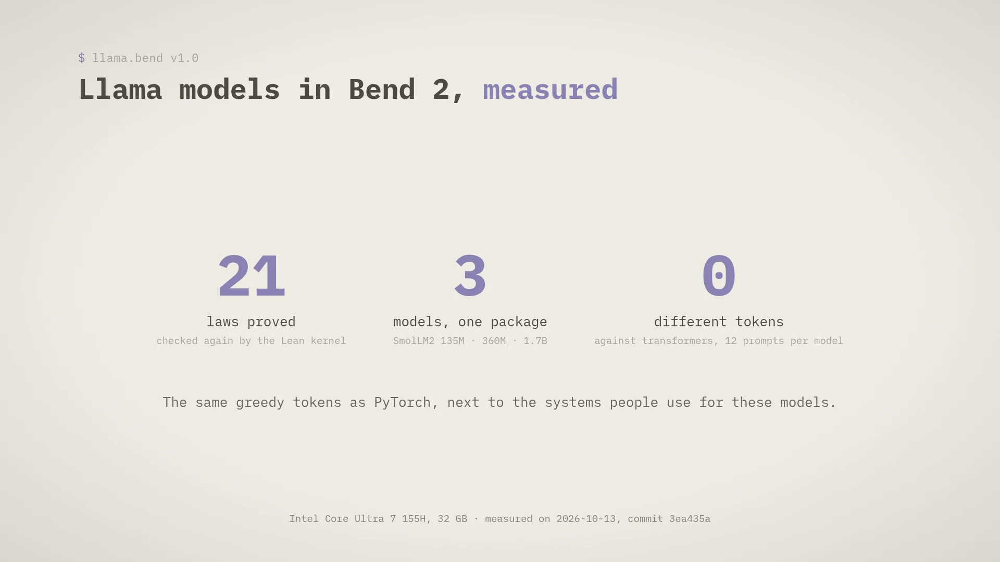</p>

## 01 · A weight in the wrong place is a type error

<p align="center">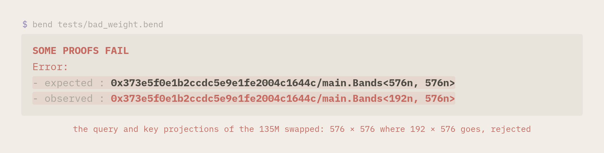</p>

```python
# the weights of one layer, with their shapes from the config c (row = output, as PyTorch stores them)
type LW<-c: Cfg> is Type:
  LW{ln1: List<&2, F32>, q: TA.Bands<Cfg.dim(c), Cfg.dim(c)>, k: TA.Bands<Cfg.kvw(c), Cfg.dim(c)>, ...}
```

SmolLM2-135M has 9 query heads but only 3 key/value heads, so its `q` is 576 × 576 and its `k` is 192 × 576. Swapping
them ([`tests/bad_weight.bend`](tests/bad_weight.bend)) is rejected before anything runs. The same goes for the
key/value cache: its type `KV<cap, t>` carries its capacity and the number of positions written, and every write asks
for a proof that the position is below the capacity. A third write into a cache made for two positions needs a proof
that 2 < 2 ([`tests/bad_cap.bend`](tests/bad_cap.bend)):

<p align="center">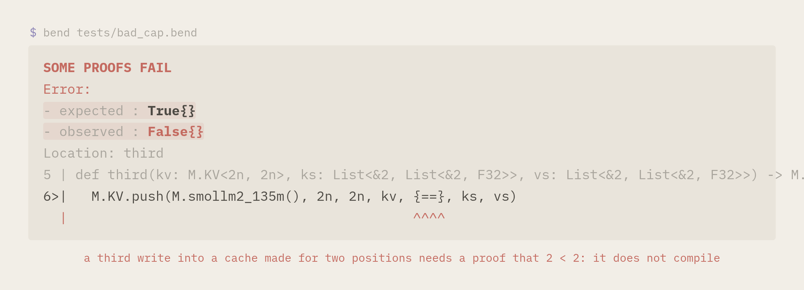</p>

The proofs are erased when the program is compiled: they cost nothing at run time. `make laws` checks that both
programs are rejected.

## 02 · Laws, not trust

<p align="center">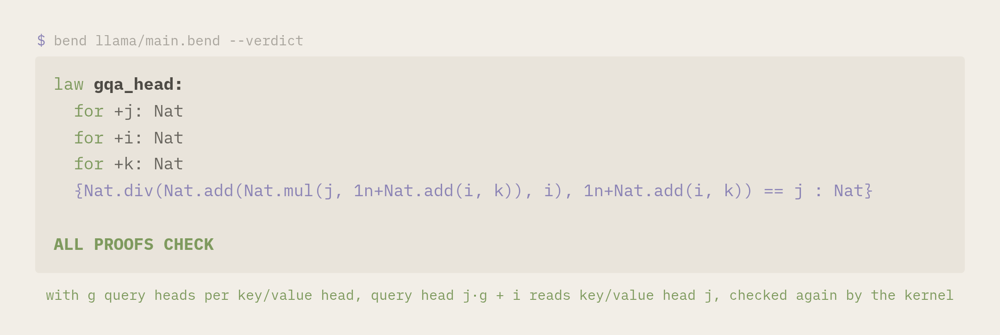</p>

| Law | In plain language |
|---|---|
| `gqa_head` | with g query heads per key/value head, query head j·g + i reads key/value head j, the mapping `transformers` uses; proved over `Nat.div` itself |
| `causal`, `read_len` | at position t, attention scores exactly t + 1 keys, positions 0..t, one per position written |
| `kv_room` | a cache made for `cap` positions holds every position below `cap` inside its arrays, so a write never wraps around onto position 0 |
| `groups_len`, `kv_heads`, `arrays_len` | the query heads form exactly one group per key/value head, and an empty cache holds one array of keys and one of values per key/value head |
| `head_split` | a head splits into the two halves that RoPE rotates together and joins back unchanged; the config stores half a head, so a head is always even |
| `layout_135m`, `layout_360m`, `layout_1_7b` | the shapes the types give to the weights add up to the number of values in each checkpoint (134,515,008, 361,821,120 and 1,711,376,384); the loader stops on any file whose size differs from its type |

Each one is explained at length in [`llama/README.md`](llama/README.md#the-laws-in-plain-language), next to the
arithmetic lemmas they use. `bend llama/main.bend --verdict` checks them again with Bend's kernel proved in Lean, with
no `@unsafe`, no `?TODO` and no axioms. The numbers are a different matter: `F32` is not a real number, so the numerics
are tested against PyTorch instead of proved.

## 03 · It runs, and it computes the same thing

<p align="center">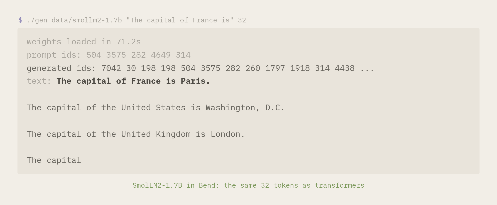</p>

All against `transformers` 5.19 in F32 with eager attention, by the scripts in [`reference/`](reference/):

| | SmolLM2-135M | SmolLM2-360M | SmolLM2-1.7B |
|---|---|---|---|
| config | 3 key/value heads × 3 query heads, 30 layers | 5 × 3, 32 layers | 32 × 1, 24 layers, RoPE base 130,000 |
| logits, worst error relative to the largest logit (11 prompts) | 2.1e-5 | 4.8e-5 | 8.3e-5 |
| argmax at each of the 88 positions | the same | the same | the same |
| 32 greedy tokens and decoded text (12 prompts) | identical | identical | identical |

The tokenizer is written in Bend too (SmolLM2's digit split, the GPT-2 regex and 48,900 merges). It gives the same ids
as `tokenizers` on 68 fixed texts and 600 random ones, and decodes like it on 1,500 random id sequences, most of them
invalid UTF-8.

## 04 · How it compares

<p align="center">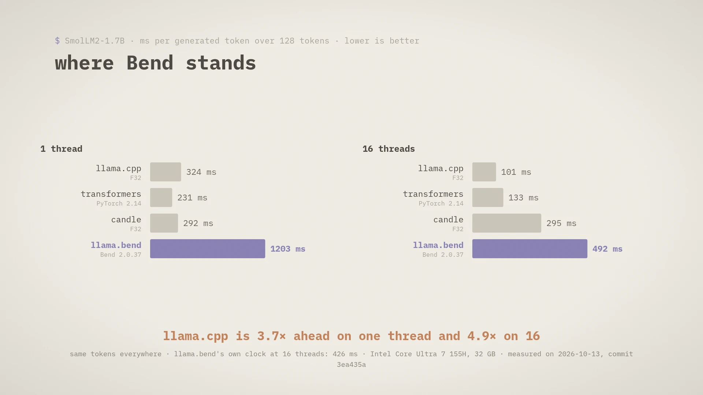</p>

<p align="center">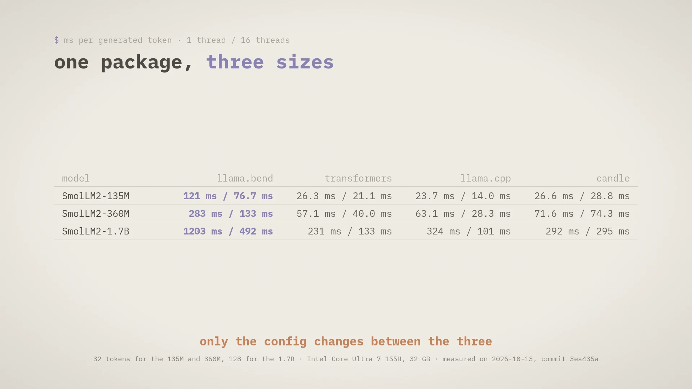</p>

<p align="center">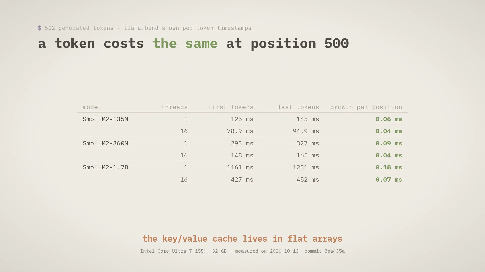</p>

<p align="center">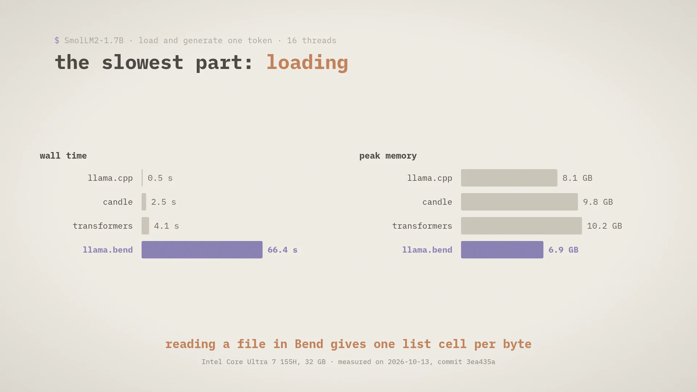</p>

Every system generates the same tokens. llama.bend is 3.7 to 4.9 times slower than llama.cpp on the 1.7B. Loading was
its slowest part; since 2026-10-16 it takes 9 s instead of 66. The 1.7B's totals carry the noise of loading it in both runs of a sample: by its own clock,
llama.bend takes 426 ms per token at 16 threads. The machine, the versions and every number are in
[`BENCHMARK.md`](BENCHMARK.md).

<p align="center">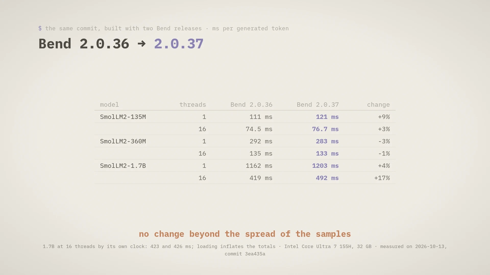</p>

Bend 2.0.37 brings my fix for parallel code with an erased last parameter and a better spread of late forks over
idle threads. Built with 2.0.36 and with 2.0.37, the same commit runs at the same speed: no def here had the shape that
the fix is about, and the parallel heads gain nothing more on this machine.

## 05 · Reproduce

Linux x86_64 (or WSL), clang, Python 3.14 (the version the pinned dependencies were tested with), `curl`. About 2 GB
of disk for the 135M: 1.2 GB for the Python venv with PyTorch, 0.9 GB for the model's files.

```bash
git clone https://github.com/nuxyel/llama.bend.git && cd llama.bend
make setup   # Bend 2.0.37 (SHA256-checked), Lean 4.34.0, the Python venv of reference/; no sudo
make prep    # SmolLM2-135M at a pinned revision into data/smollm2-135m/, checked
make check   # the laws (--verdict), the rejected programs, then every test above against tokenizers and transformers (~4 min)
bend demo/gen.bend -o gen && ./gen data/smollm2-135m "The capital of France is" 32
```

The other models are one variable away: `make prep check MODEL=smollm2-360m`, or `MODEL=smollm2-1.7b`.
`reference/models.py` pins each one to a revision. In your own Bend program:

```python
import bend-ml-llama@0.1.0.0/main.bend as M
```

`make bench` is a one-command benchmark for optimization loops: it builds the generator with the `bend` on your PATH,
generates 128 tokens on the 135M, fails if they differ from `transformers`' (`bench/`), and prints one line
(`ms_per_token=... load_s=... tokens=128 ok`). `MODEL=` and `THREADS=` pick the model and the thread count.

`make media` regenerates the figures on this page from real runs (needs node, ffmpeg and Brave). CI runs `make check`
on every push. `main` holds the released versions; work in progress lives on `devel`.
Contributions are welcome: see [`CONTRIBUTING.md`](CONTRIBUTING.md) (pull requests go to `devel`).

## 06 · Limits

- **Slower than the references** ([`BENCHMARK.md`](BENCHMARK.md), 2026-10-13). On the 1.7B over 128 tokens at 16
  threads, llama.bend takes 492 ms per generated token (426 by its own clock), `transformers` 132 and llama.cpp 101; on
  one thread, 1.2 s against 0.23 and 0.32. The cost of a token does not grow with the position. What remains is the
  weight products, and still loading: 9.1 s to load the 1.7B and generate one token (66 s before the loader moved to
  `bend-ml-binary-read`, 2026-10-16), against 4.1 s for `transformers` and 0.5 s for llama.cpp. Peak memory 6.9 GB at 16 threads, 8.4 GB
  on one.
- CPU only; base models, greedy decoding, no chat template. The vectors between layers are lists whose length is not
  in their type, and the numerics are tested, never proved.

## Where things are

| Path | What |
|---|---|
| [`llama/`](llama/) | the package `bend-ml-llama`: config, layers, model, loader and laws (`main.bend`); the fast loader the demos use (`load.bend`) |
| [`demo/`](demo/) | `gen.bend` (generation), `forward.bend` and `layer_test.bend` (what the tests read), the tokenizer |
| [`tests/`](tests/) | programs that must not compile |
| [`reference/`](reference/) | download and preparation, the `transformers` and `tokenizers` oracles, the tests |
| [`BENCHMARK.md`](BENCHMARK.md) | the numbers in section 04, with the machine and the method |
| [`NOTES.md`](NOTES.md) | every finding, measurement and decision, by date |
| [`docs/plan.md`](docs/plan.md), [`docs/bendtorch.md`](docs/bendtorch.md) | the milestones; what a backward pass would need |

## Upstream

While building bend-ml I found that a parallel let became sequential when its def's last parameter was erased
([bendlang/bend#1374](https://github.com/bendlang/bend/issues/1374)). My fix,
[#1377](https://github.com/bendlang/bend/pull/1377), is in Bend 2.0.37, the version this project runs on.

<p align="center"><sub>MIT · Renan Vinícius (@nuxyel) · the visual identity is bend-ml's, in Bend's own colours · the launch video (v1.0): <a href="https://github.com/nuxyel/llama.bend/releases/download/v1.0.0/llama.bend.mp4">llama.bend.mp4</a></sub></p>
